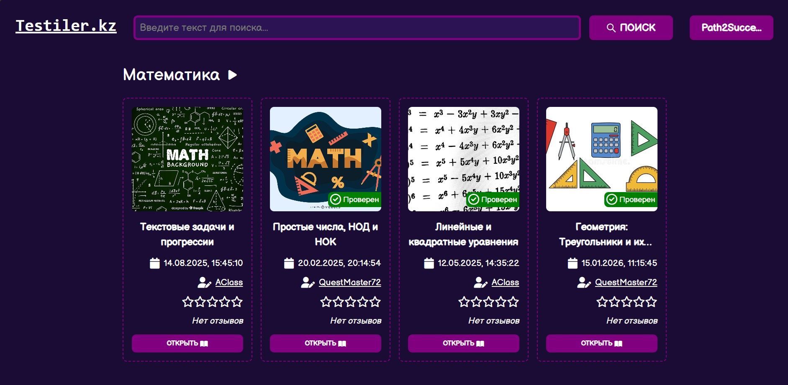
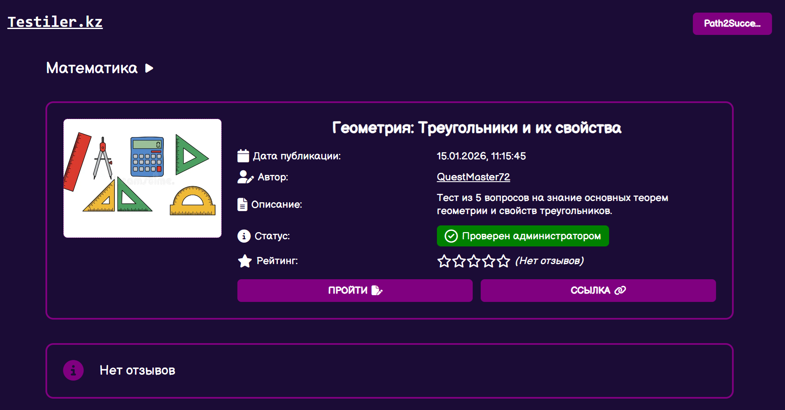
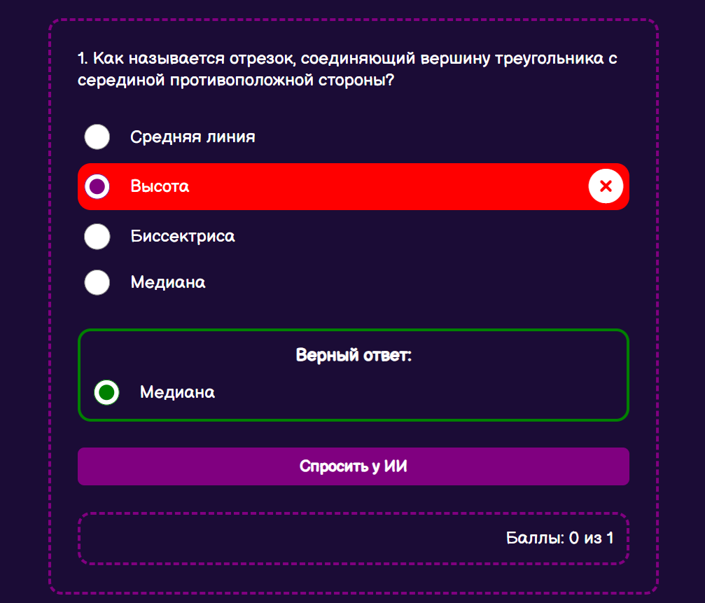
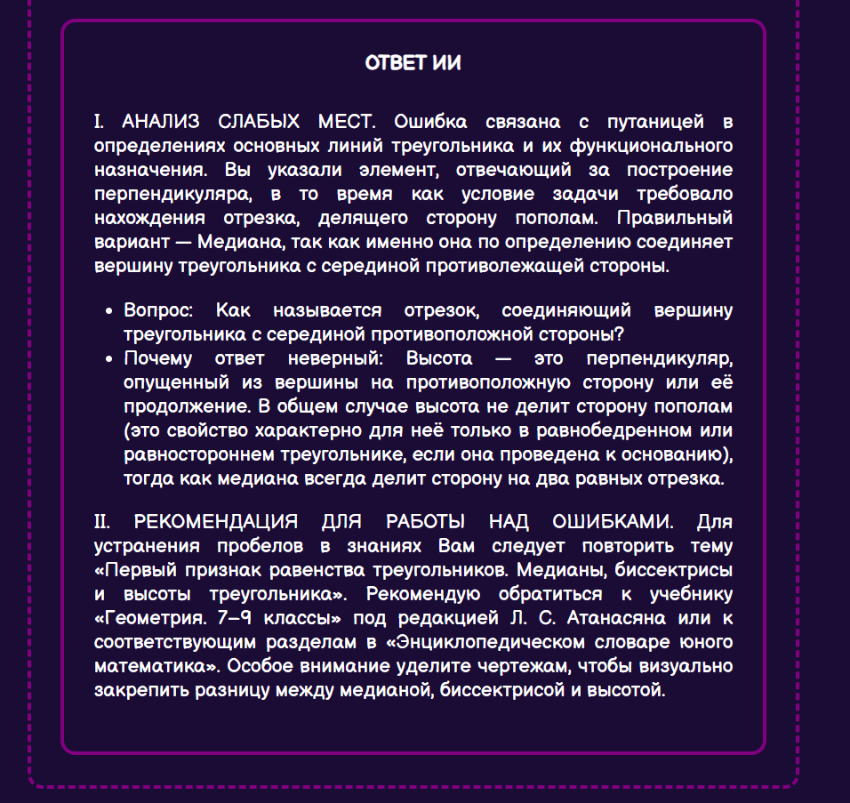

# Testiler_KZ

Testiler_KZ — это платформа, предназначенная для создания и прохождения тестов.

## 🛠 Архитектурный стек

### Backend:
* **Платформа:** .NET 8 / ASP.NET Core Web API.
* **СУБД:** SQLite.
* **ORM:** Entity Framework Core.

### Frontend:
* **Ядро:** Vanilla JavaScript (ES6+).
* **UI-компоненты:** CSS, иконки FontAwesome.

## 📸 Скриншоты интерфейса
### Главная страница пользователя:


### Информация о тесте:


### Неверный ответ:


### Разбор ошибочно ответа с ИИ:


### Искусственный интеллект
В проекте осуществлена интеграция Gemini API для автоматизации генерации вопросов, грамматической проверки добавленных вопросов, а также помощи в работе над ошибками после прохождения тестов.

---

## 🚀 Запуск проекта
1. Настроить ключ Gemini API и перезапустить IDE:
```bash
setx GOOGLE_API_KEY "ВАШ_КЛЮЧ"
```

2. Клонировать репозиторий:
```bash
git clone https://github.com/kaisar-tokbolat-dev/Testiler_KZ.git
cd Testiler_KZ
```

3. Запустить проект:
```bash
dotnet run
```